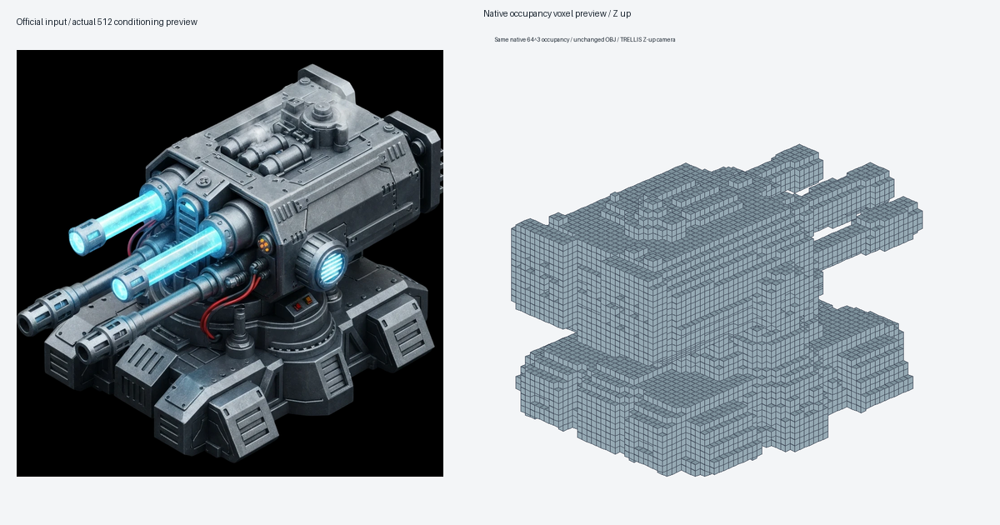

# One genuine object-conditioned sparse occupancy experiment

**PASS against the predeclared diagnostic criterion.** Exactly one DINO pass, one 12-step sampling sequence with 22 model forwards, and one sparse-decoder forward completed on RX 9070 XT. Native64³ occupancy contains **18,660 voxels (7.118225%)**, all in one six-connected component with D/H/W bounds `[11,0,13]`–`[52,63,51]`, spans **42×64×39**. It is nonfull and exceeds eight cells on every axis. This proves escape from the previous 64×24×2 slab under an image-only substitution, not correct detailed geometry.

Base: `39ddc2bf890949676694b4bbfca74f7fd34ea18a`. Branch: `codex/amd-object-conditioned-occupancy`. Reviewed execution harness **`aeb5173bda5b414ce99274ec4764799968d4f56c`** was committed, pushed and independently verified on GitHub before the exclusive sequence. No retries, extra model stages or parameter tuning followed it.

## Input and unchanged numerical contract

Selected Microsoft's [official mechanical-turret example](https://github.com/microsoft/TRELLIS.2/blob/75fbf0183001ed9876c8dbb35de6b68552ee08bd/assets/example_image/0f168a4b1b6e96c72e9627c97a212c27a4572250ff58e25703b9d0c2bc74191a.webp), pinned commit `75fbf0183001ed9876c8dbb35de6b68552ee08bd`. It has substantial body/base depth, visible top and side surfaces and real mechanical detail. Original 1042×1042 RGBA has fully transparent background and nondegenerate alpha > 204 foreground. Source SHA256 **`a8d419ac16852b73fbc7b92c6857ba5d4be2f2dd8056bf44af707e6af4d62207`**, Git blob SHA1 `d565e59280e661dee2d9b5d02b581ef82fe3a6da`, matches the official listing. Two other inspected candidates are retained only as selection evidence.

[Input contract](amd-object-conditioned-occupancy-evidence/input-contract.json) records decoded pixels, original bytes, CPU-generated PNG and real alpha-only932×932RGB crop followed by the extractor's 512-pixel LANCZOS resize. The actual AMD Python 3.12.10 / Pillow 12.3.0 independently reproduced all three pixel/PNG/crop identities without Torch imports. RMBG remained absent.

Unchanged: seed 20261013; exact CPU-noise SHA `f76e94b25a4798a5da0e9de56667b5dda38e75bf12ccbc373521fbcd7af1a7b3`; sigma_min1e−5; 12 Euler steps; rescale_t 5; guidance 7.5 / rescale 0.7 / interval [0.6,1]; dino_lock 0. Twelve positive plus ten negative calls, each with exactly one approved timestep-frequency transfer. Strict checkpoint/dtype contracts, generated RoPE policy, SDPA backend, genuine decoder and `decoded > 0` were retained. No latent normalization, transpose, threshold adjustment or32³pooling occurred.

Real checkpoints remain DINO `dcb2e451…18179`, sparse flow `ca01377c…7abf6`, decoder `1c76d4a4…09a`; [CPU admission](amd-object-conditioned-occupancy-evidence/cpu-admission.json) records full hashes. Runtime: PyTorch 2.13.0+rocm10.0.0, HIP 7.15.26333, CUDA build metadata null, RX 9070 XT/gfx1201, total 17,095,983,104 bytes. `cuda:0` is PyTorch's ROCm device interface; no CUDA binaries or CPU computation fallback were substituted.

## Execution and release

| Stage | Strict CPU load | Synchronized computation | Supervised worker | Peak allocated / reserved bytes |
|---|---:|---:|---:|---:|
| DINO, F32 `[1,1029,1024]` |1.984s|23.829s|53.453s|1,343,300,096 /1,371,537,408|
| Sparse sampling, F32 `[1,8,16,16,16]` |10.984s|7.922s|32.344s|2,918,161,408 /3,038,773,248|
| Decoder, F32 `[1,1,64,64,64]` |1.531s|21.187s|30.484s|1,127,093,760 /1,648,361,472|

Summed measured computation 52.938s; supervised worker times 116.281s, excluding parent pre/post checks. Fresh CPU RAM 18,947,444,736 bytes exceeded 11,411,181,632. Each worker began with zero allocations/reservations and 16,937,582,592 available VRAM bytes. Existing DINO admission and sampler/decoder 12 GiB caps remain unchanged; sampler/decoder require≥13GiB available before placement. CPU/GPU/overall limits remain 120/180/360, 180/240/480, 120/180/360 seconds.

All three releases measured **zero allocated/reserved PyTorch bytes**, collected owned model/tensor references, cleared the approved BLAS workspace once and exited 0 with empty owned Jobs. All periodic Windows samples were healthy; maximum gaps DINO 7.641s, sampler 5.031s, decoder 5.047s. No timeout, native error, GPU reset or forced cleanup. Global driver/context memory is distinct from PyTorch allocations; no post-exit GPU query was added.

## Preserved artifacts and independent checks

All paths below are inside `C:\Users\wattz\Documents\ChatGPT\modly\proof\docs\compatibility\amd-object-conditioned-occupancy-evidence`.

| Artifact | Bytes | Complete-file SHA256 |
|---|---:|---|
|[conditioning.safetensors](amd-object-conditioned-occupancy-evidence/conditioning.safetensors)|4,215,800|`78a0b54210568624639c8cacb7a803d83d4b838b782ea54e7aceab749d47e17a`|
|[sparse-structure-latent.safetensors](amd-object-conditioned-occupancy-evidence/sparse-structure-latent.safetensors)|134,688|`9860da7f631fec2324191f3d8098bee61d845a264415117fe1e43ccc1a5a7332`|
|[occupancy-logits.npy](amd-object-conditioned-occupancy-evidence/occupancy-logits.npy)|1,048,704|`5ec5e5ceb114e477177df91ba0de444dc54a9c70103f4086701b754c76a9e3c2`|
|[occupancy-mask.npy](amd-object-conditioned-occupancy-evidence/occupancy-mask.npy)|262,272|`b30f83758f79a0a512e15e303da9392a4b95d15b50fcd41071ca85da40f191c5`|
|[occupancy-coordinates.npy](amd-object-conditioned-occupancy-evidence/occupancy-coordinates.npy)|298,688|`fc8c67e1b0de4162fbb555339570a2c4595012a957e1a5c8325103a479018069`|
|[voxel-preview.obj](amd-object-conditioned-occupancy-evidence/voxel-preview.obj)|863,138|`5fa58c438aa29f40e6ecd7a5c169d26ed25263bacbc3ab5f6519e61628d432da`|
|[voxel-preview-z-up.png](amd-object-conditioned-occupancy-evidence/voxel-preview-z-up.png)|45,751|`0ab3d2bf9718519a58005e13a3266650f91e681ab451734d931baded7ac74c59`|

Independent CPU stdlib checks validated complete bounded safetensors/NPY headers and finite payloads, full provenance chain, exact threshold, ordered coordinates including Fortran storage, connectivity, unchanged noise/settings and invocation counts. [Sequence validation](amd-object-conditioned-occupancy-evidence/independent-sequence-analysis.json), [occupancy validation](amd-object-conditioned-occupancy-evidence/independent-result-analysis.json) and [surface validation](amd-object-conditioned-occupancy-evidence/voxel-preview-independent.json) passed. A post-run verifier initially used nonexistent `invocations` instead of the actual `models` JSON field; the saved schema correction changed only that CPU reader. Historical/execution evidence and counters were untouched; no GPU rerun.

OBJ has 24,543 vertices / 24,546 outward unit quads, below 50,000 faces / 12 MiB. Original fixed Y-up PNG is preserved. A separately labelled CPU camera view uses the pinned renderer's Z-up convention, preserving the exact OBJ, mask and coordinates. It shows a plausible coarse turret body, base and barrel-like protrusions; silhouette, fine detail and correct geometry remain unproved. This is diagnostic occupancy surface, not a shape-SLat mesh. Only view projection changed after execution.

## Preservation and next action

28 focused CPU tests and independent pre-execution review passed. Sandbox-only path permission failures are preserved; the scoped authorized rerun and actual AMD-Python image check passed without AI imports. No broad application suite ran.

[Preservation](amd-object-conditioned-occupancy-evidence/git-after.json) verifies all 4,147 historical artifact hashes, main/prior branch identities, AMD source HEAD/status and existing `nodes.py`/backup bytes. Installed before/after inventory files are byte-identical. Raw venv/model-cache snapshots match the previous published baseline byte-for-byte: SHA256 `ccfc309cb9898ba4988a07de3b14f3e5b41679e1bc230d19239c210645ff5af7` and `a60087740c1cf56b94a4909622ca9036a01d014d403d5bdbd3e1079c01fae8fe`. Private runtime cache products remain local, ignored and hash-manifested; bounded artifacts/logs are published. No installation, installed-environment/driver/VM/AMD-source edit, weight download, shape-SLat, CuMesh, texturing or GLB work occurred.

**Single best-supported next action, requiring approval:** one bounded shape-SLat loading/one-forward proof using these saved conditioning features and source-derived occupancy coordinates, beginning with strict CPU contract/admission validation. Reuse these artifacts; do not repeat DINO, sparse sampling or decoding. Its sparse/native computation and memory requirements must be established before execution. Full shape sampling, extraction and the earlier CuMesh 719 risk remain unvalidated. Stop after this publication.
