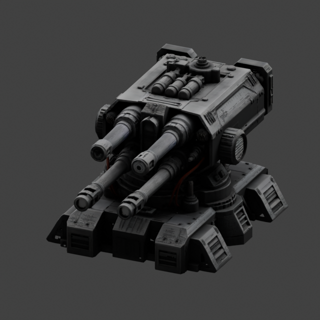
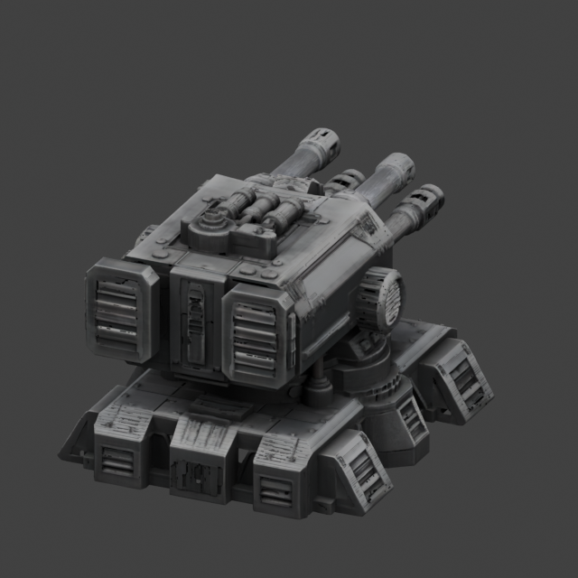

# Genuine turret learned-colour preview — PASS

Base `fa3a98c78c98cd12c6b45bab3a1fcaacc3db97d9`; branch `codex/amd-turret-learned-colour-preview`.

**PASS: direct-row learned-colour preview, not the final source-faithful trilinear PBR bake.** These are the actual unchanged turret and learned RGB values. No manual barrel recolouring or emission was added.

The real result is predominantly dark/neutral with restrained red and blue details. The vertex colours are connected to the shader and survived reopening the saved Blender project; this is not Blender's default grey material. No colour saturation or brightness boost was applied to manufacture stronger accents. The three views are qualitatively cleaner than the earlier eight-sample previews; all have zero pixels with any channel at or above 254.

## Exact correspondence and preservation

The saved original extractor computes one dual-grid vertex per neural row and writes that array without sorting or dropping rows. Its sorted coordinate table is used only for neighbour lookup and maps back to original indices. Independent CPU inspection recomputed **every** vertex bitwise from its original neural row, verified original PLY versus NPY arrays and compared the geometry/material coordinate arrays byte-for-byte: SHA-256 `c87fa21d6f863aced647b48e0bb2edebe32523d36c742e350d39ccfea3fc0934`.

The derived binary PLY retains **1,842,968 original vertices and 4,012,360 original triangles**, including exact XYZ bytes, face-record bytes, indices and winding. Every derived RGB byte equals `rint(clip(learned_RGB,0,1)*F32(255)).astype(u1)` at that same row. Only 434 RGB components required clamping; the original unclamped material file remains byte-identical. Blender's imported geometry and colour arrays were checked before/after rendering and after independently reopening the saved scene.

[Row correspondence](amd-turret-learned-colour-evidence/row-correspondence-review.json) | [Independent full coloured-PLY check](amd-turret-learned-colour-evidence/independent-coloured-ply-review.json) | [Saved-scene readback](amd-turret-learned-colour-evidence/scene-readback.json) | [Independent outcome/code review](amd-turret-learned-colour-evidence/independent-outcome-review.json).

## Windows outputs

Directory: `C:\Users\wattz\Documents\ChatGPT\modly\artifacts\amd-turret-learned-colour-fa3a98c`

| File | Bytes | SHA-256 |
|---|---:|---|
| `turret-learned-colour.ply` | 79,805,490 | `d79f6fb38d23e2f0c7bcc492153290d67767466411f71dc19fcc5c6540ceeb72` |
| `learned-colour.blend` | 97,205,266 | `b5c91db6b4c9717da987ab7c6d65ba495f78b0fcb87cd10e0ad3944dc1e17632` |
| `preview-front.png` | 406,300 | `262aa6f754954c09a9d17fab77f6003f425ac1dec0331b5ee956add9363d7955` |
| `preview-side.png` | 385,481 | `ff3319685760ef59351b4e6f96295675e589bdef883d15d6a603c79ba8b9325e` |
| `preview-rear.png` | 409,443 | `0ddd758fa08286a1cb74b1e59cf4562fef6a34a8b6960e069b0637636a94103f` |

The usable `.blend` contains the full unchanged geometry, verified vertex-colour shader, three named cameras, front camera active and a vertex-colour viewport. `conversion.json`, `render-metadata.json` and `verification.json` are preserved beside it. Large PLY/Blender files stay outside Git; the small original PNGs and verification evidence are published.

## Bounded CPU rendering

Blender **5.2.1 LTS**, Cycles CPU, four threads, **64 samples**, built-in **CPU OpenImageDenoise**, soft neutral area lights, AgX neutral view transform, exposure0. RGB alone is previewed with uniform roughness0.8/metallic0/opaque alpha and emission0; learned metallic/roughness/alpha are preserved in the source but are not baked or reconstructed here. sRGB byte interpretation is explicit, with full imported-colour readback.

One three-view render process completed in **40.406s**, peak committed memory **2,224,345,088 bytes**, within the retained **6GiB / 180s** safeguards. A separate **non-rendering** CPU scene readback took **6.015s** under its own bounded Job. Both exited0 with naturally empty Jobs and no forced cleanup. Three focused converter tests passed; no old broad suite was rerun. Source PLY, genuine material file, original neural output and canonical NPY arrays were rehashed unchanged after completion. Existing source code, environments and historical branches were preserved.

[Actual render settings/cameras](amd-turret-learned-colour-evidence/render-metadata.json) | [Host process result](amd-turret-learned-colour-evidence/preview-host.json) | [Complete output hashes and source preservation](amd-turret-learned-colour-evidence/verification.json).

No WSL, Torch, ROCm, TRELLIS.2 execution, model/checkpoint loading, new native build, topology repair, remeshing, decimation, UV unwrapping, texture bake or GLB export occurred. Stop after this preview.
