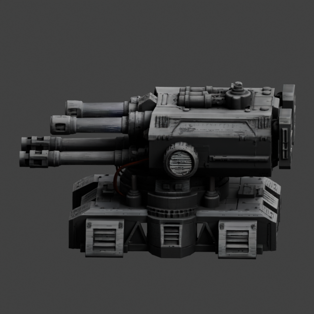
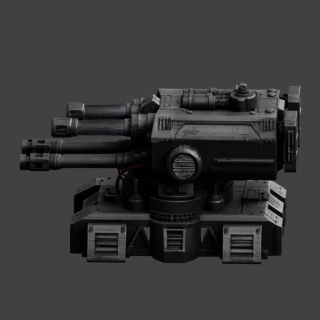

# Genuine learned-PBR side preview — PASS

Base `34852634524cebfd8dbd7746386dffa614a29058`; branch `codex/amd-turret-learned-pbr-preview`.

**PASS for one bounded CPU-only direct-row learned-PBR preview. Visual improvement is modest:** the learned metallic/roughness values add localized highlights and a slightly darker metallic response. They do not substantially improve colour or detail under the unchanged neutral lighting. No saturation, lighting, emission or colour adjustment was made after viewing the result. This is not the final source-faithful trilinear PBR bake.

| Existing learned-RGB preview | RGB + learned metallic and roughness |
|---|---|
|  |  |

## Genuine inputs and shader

The original `.blend` SHA-256 remains `b5c91db6b4c9717da987ab7c6d65ba495f78b0fcb87cd10e0ad3944dc1e17632`; the complete material field remains `7b24c946765d8e5de9718dbc358ce35141a56d836aa54fe7f8945cb1acbf7a80`. The previously proved exact vertex/material row relationship was reused and the material coordinate payload rechecked against `c87fa21d6f863aced647b48e0bb2edebe32523d36c742e350d39ccfea3fc0934`.

All **1,842,968 vertices / 4,012,360 triangles**, their position/index bytes, winding and the original RGB attribute/link remain unchanged. New **FLOAT / POINT** attributes retain genuine raw F32 metallic (column3), roughness (column4) and alpha (column5), including original out-of-range values. Metallic and roughness use `Attribute.Fac -> MINMAX Clamp[0,1] -> Principled` inputs. Only the derived shader is clamped: 397 metallic and 23 roughness values lie outside0–1. Raw alpha is stored unchanged but unlinked; shader alpha stays1 and emission stays0.

| Raw attribute | Minimum | Maximum | Mean |
|---|---:|---:|---:|
| Metallic | -0.0250363 | 1.046319 | 0.482825 |
| Roughness | -0.0294787 | 0.763884 | 0.590872 |
| Alpha, retained only | 0.992832 | 1.008357 | 1.000018 |

A separate non-rendering Blender process reopened the saved scene. Every raw attribute value was compared bit-for-bit with the genuine field; actual clamp/link endpoints, opaque alpha, zero emission, geometry bytes and unchanged RGB were verified. Camera, all lights/world, colour management, seed and render settings match the original scene. [Readback](amd-turret-learned-pbr-evidence/scene-readback.json) | [Metadata/settings](amd-turret-learned-pbr-evidence/render-metadata.json) | [Independent review](amd-turret-learned-pbr-evidence/independent-outcome-review.json).

## Actual outputs and bounds

Fresh Windows directory:

`C:\Users\wattz\Documents\ChatGPT\modly\artifacts\amd-turret-learned-pbr-3485263`

| File | Bytes | SHA-256 |
|---|---:|---|
| `learned-pbr.blend` | 114,365,124 | `555ef22321040a806b8d21cad65087eb0b424d46e6d9ed8a2a11c6a49cc79339` |
| `preview-side.png` | 381,526 | `ee3c38db6071f01b0aff7810677dd3cff04c8f8e6dc2fb667050cedb7c100143` |

`render-metadata.json` and `verification.json` are preserved beside the scene/image. The large Blender project remains outside Git; the original PNG and small evidence are published here.

Blender **5.2.1 LTS**, Cycles **CPU**, four threads, **64 samples / CPU OpenImageDenoise**, 640×640. One side-view render took **8.726s**; the complete render/load/verify/save process took **27.468s**, peak committed memory **2,280,869,888 bytes**, within the **6GiB / 180s** limits. Saved-scene CPU readback took **15.750s** under a separate60s bound, with no render. Both processes exited0, owned Jobs naturally emptied and no forced cleanup occurred.

The identical-view pixel comparison has mean absolute channel difference **3.961/255**; 95,385 pixels differ by more than5 in at least one channel. This describes image changes, not a perceptual-quality score. No PBR pixel reaches254 in any channel. The modest qualitative result was accepted without retuning or rerendering. Three focused channel-contract CPU tests passed; no old test suite was repeated.

[Complete verification/source preservation](amd-turret-learned-pbr-evidence/verification.json) | [Render containment](amd-turret-learned-pbr-evidence/render-host.json) | [Non-rendering readback containment](amd-turret-learned-pbr-evidence/readback-host.json).

Original scene, raw material field, mesh, geometry outputs, canonical arrays, RGB reference and historical branches remain preserved. No Torch, ROCm, WSL, TRELLIS model execution, geometry modification, UV unwrapping, baking, repair, simplification, package/driver change or GLB export occurred. Stop after this preview.
