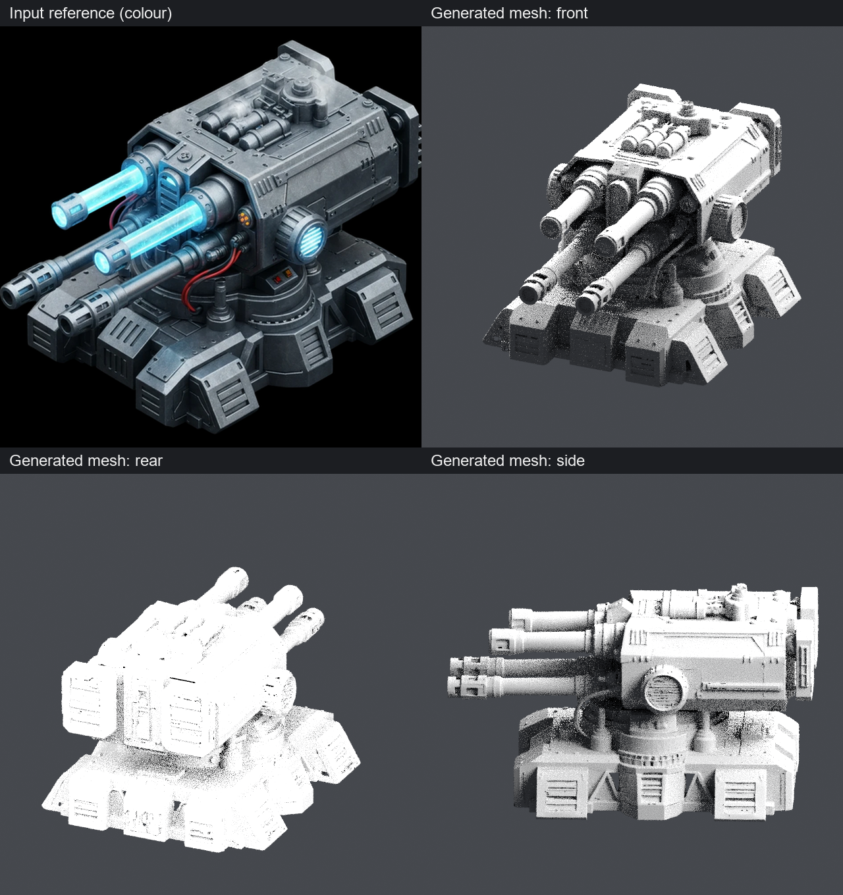

# Genuine turret: three CPU previews — PASS

Base: `9380d3ab4f47722c2fa624165517c88af9d6acfd`. Branch: `codex/amd-turret-visual-preview`.

**PASS for the authorised visual preview.** One Blender process produced all three images from the unchanged full-resolution PLY. The previous non-manifold/boundary findings remain unchanged; this result does not qualify topology or mesh repair.

## Actual pictures and files

Windows directory: `C:\Users\wattz\Documents\ChatGPT\modly\artifacts\amd-turret-preview-9380d3a`

| PNG | Dimensions | Bytes | SHA-256 |
| --- | --- | ---: | --- |
| [Front](amd-turret-visual-preview-evidence/previews/preview-front.png) (`preview-front.png`) | 640×640 | 482,627 | `daab47d2121783a5ae4db9b9d7481d7815c0d44cc07ce94bb4bf83625689a252` |
| [Rear](amd-turret-visual-preview-evidence/previews/preview-back.png) (`preview-back.png`) | 640×640 | 342,223 | `5a7c56cc123ae7816279e6003380afeacfe3b4bf8d176a76988e54fca2bdfdea` |
| [Side](amd-turret-visual-preview-evidence/previews/preview-side.png) (`preview-side.png`) | 640×640 | 478,080 | `31ce5a683e7edda2c542dcd19f80f3b499e878b583cb37d10041a0b2239c3588` |

`comparison.png` (1,650,960 bytes) lays out the original conditioning reference and these three unchanged renders. Its SHA-256 is `ed3076db43a4fd106ade089e6e9e01fd06acd7f1b04429a4a2e64b34ae1a92cc`. `render-metadata.json` (3,241 bytes) records exact paths, hashes, camera positions/quaternions, orthographic scales, import settings and timings. Copies of the PNGs and metadata are published with this report.

**Visual assessment:** the four barrels, angular housing, circular mount and segmented base make the turret clearly recognisable and broadly resemble the input. This is a qualitative comparison, not a camera-aligned silhouette metric. Hidden-side fidelity cannot be established from the single reference image. The quick eight-sample renders are visibly grainy and highlights clip, particularly at the rear; that limits fine surface assessment. No second render, denoising or image enhancement was attempted.

## Execution and preservation

- Blender **5.2.1 LTS**, Cycles **CPU**, four threads, eight samples; neutral grey rough material, fixed lighting, +Z-up orthographic cameras. No smoothing, modifiers, vertex merging, repair, reorientation or scale change.
- The original **1,842,968 vertices and 4,012,360 triangles** were retained. Blender's actual coordinate and triangle-loop arrays matched the saved NPY arrays exactly **before and after** rendering, including index order and winding.
- Script duration **8.560 seconds**; complete supervised process **13.391 seconds**. Peak committed process memory **1,597,411,328 bytes**, below the unchanged **6 GiB** cap. Available RAM admission was **18,758,627,328 bytes**, above 10 GiB. The 180-second deadline remained enforced.
- Blender exit **0**; owned Windows Job empty without forced cleanup. No resource-heavy retry occurred. Independent review caught an attachment-failure cleanup edge case before launch; the narrow host fix terminates only its own unattached child. Existing containment was retained.
- The original PLY remains byte-identical: SHA-256 **`89549a36c6acc6f884174a2097ad7e346980d565c999117ea29f89cda9baad1a`**, 74,276,526 bytes. Independent host verification after termination matched all **51** protected files, including the original neural artifact, mesh/arrays/provenance, prior extraction code/evidence and Blender executable, with unchanged sizes and timestamps.

The known **338,449 non-manifold edges and 164,154 boundary edges were not modified**. No decoder, checkpoint, FlexGEMM, O-Voxel, WSL neural work, GPU generation, package installation or texture baking ran. Historical branches and evidence were preserved. Rendering is complete; stop before geometry repair or texturing.

[Host result](amd-turret-visual-preview-evidence/preview-host.json) · [camera/render metadata](amd-turret-visual-preview-evidence/render-metadata.json) · [output verification](amd-turret-visual-preview-evidence/output-verification.json) · [preservation verification](amd-turret-visual-preview-evidence/preservation-after.json)

[Independent outcome review](amd-turret-visual-preview-evidence/independent-outcome-review.json): accepted the preview with the stated clipping/noise limitations. All **61 prior local and remote branches**, including main and the extraction branch, were verified unchanged.
